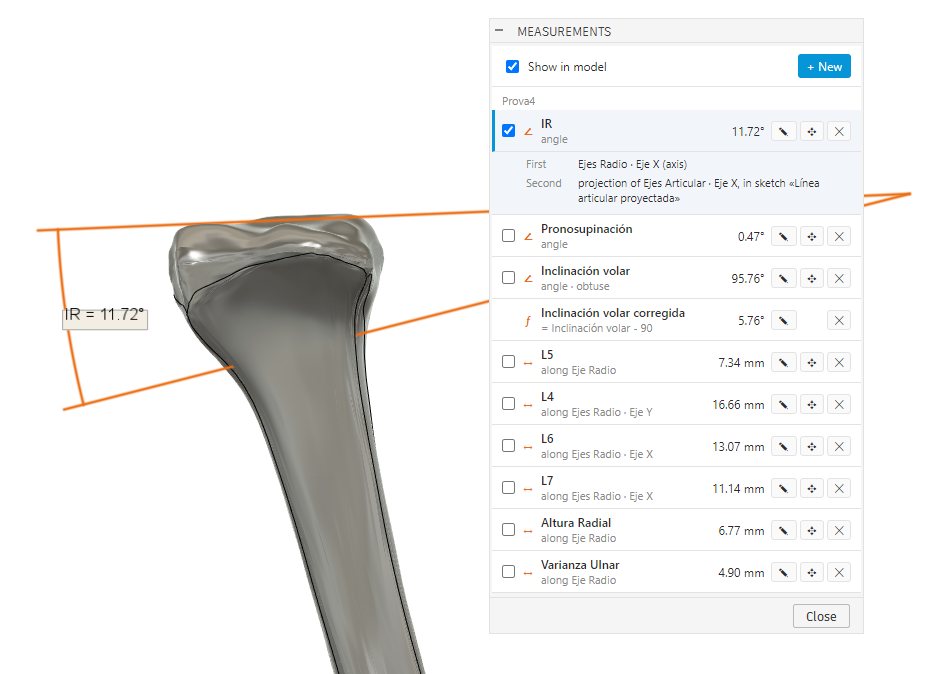
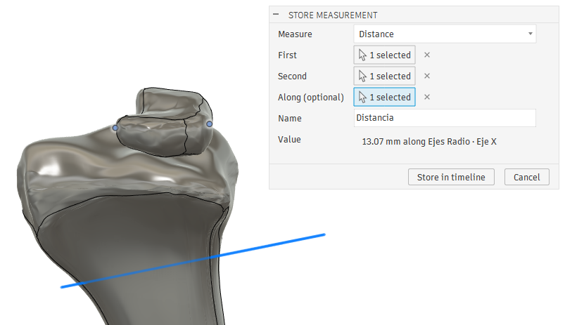
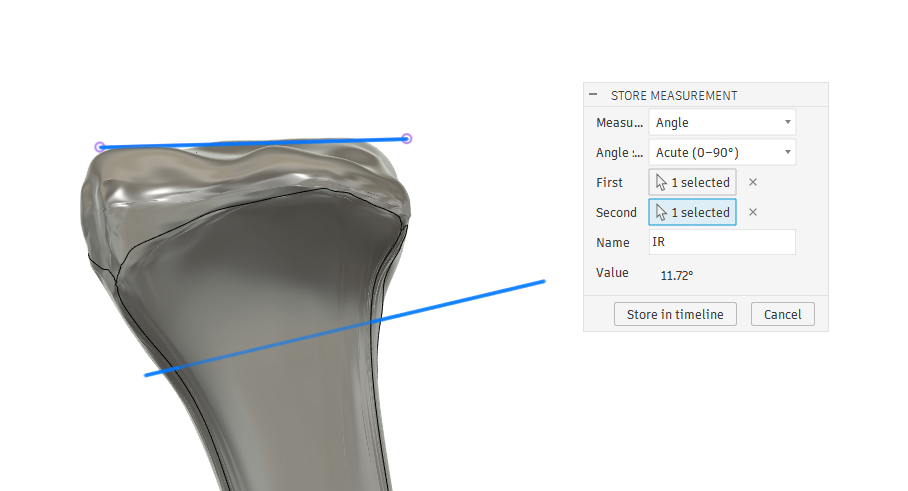
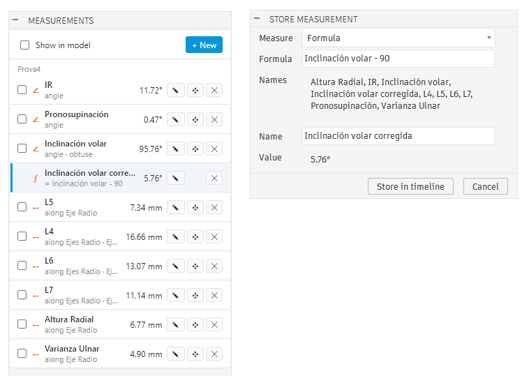

# Measurements in the timeline (MeasureTimeline)

A Fusion 360 add-in that **stores measurements in the timeline**. Each one is a distance, an
angle or a formula between entities of your design, and it **updates by itself** when the
model changes. Stored measurements are drawn in the viewport the way 3-matic shows them,
and a panel lists them all.

**Inspect → Measurements**

   
  <em>Figure 1. Measurements Dialog Overview.</em>

## Why

Fusion's Inspect → Measure gives a value and forgets it. Reproducing a radiological
measurement protocol (radial inclination, volar tilt, ulnar variance, radial height,
carpal height ratios, etc.) needs more:
- The measurements kept with the design;
- The measurements recomputed after every change;
- Each one showing what it was measured between;
- Some values that are only a component of a distance ("measure along X only"), or a
  combination of other values.

This add-in adds all of that, using the same measuring engine as Inspect → Measure.

## What it does

- **Store Measurement** ("+ New" in the panel): pick two entities (can be selected from the Project Browser or the 3D Workspace) as in Inspect → Measure
  (faces, edges, vertices, bodies, sketch geometry, construction planes, axes and points).
  - **Distance:** the minimum distance. Optionally **Along** an axis, line or plane: only
    the component along that direction (along a plane's normal), like 3-matic's "measure
    X / Y / Z only" in a user coordinate system.
  - **Angle:** the angle between lines and planes.
    - **Acute (0–90°)** is the default.
    - **Obtuse (90–180°)** is the other angle the two lines make. 3-matic shows the volar
      tilt that way, e.g. 98° = 8° of tilt.
  - **Formula:** a value computed from other stored measurements by their names, e.g.
    `IR - Pronosupination`, `90 - Volar tilt`, `L5 / L4`, `L7 / L6 * 100`. Only numbers,
    `+ - * / ( )` and measurement names are allowed (nothing is evaluated as code).

| The three kinds of measurement |
|---|
|  **Distance.** The distance between two entities. With **Along**, only its component along an axis, line or plane, as here: 13.07 mm along the radius's X axis. Leave *Along* empty for the straight-line distance. |
|  **Angle.** The angle between two lines, axes or planes, as here: *IR*, 11.72°. **Acute** (0–90°) is the default; **Obtuse** (90–180°) gives the other angle, the way 3-matic shows the volar tilt. |
|  **Formula.** A value computed from other stored measurements by their names, as here: `Inclinación volar - 90` = 5.76°. On the left, the **Measurements panel** lists every stored measurement with its value. |

  Each measurement becomes a **custom feature in the timeline**, named `label = value`. It
  depends on the measured entities, so Fusion recomputes it whenever the model changes,
  including when the document is opened.
- **Measurements panel:**
  - Lists every stored measurement with its value;
  - A **show** box per measurement, plus a master switch;
  - **Place** (move its drawing), **✎ Edit** (change its entities, *Along*, formula,
    name or acute / obtuse, keeping its place in the timeline), **Delete** and **+ New**;
  - Selecting a row lists the entities it was measured between: click one to select it in
    the design.
- **Drawing, 3-matic style:**
  - A distance as an orange line between the two closest points;
  - Its measured entities: planes as translucent green panels, axes and lines in blue,
    points as blue dots;
  - An angle as its two orange legs and the arc between them;
  - The value in a label that always faces you and keeps its size on screen.

  **Place Measurement** (double-click the feature, or Place in the panel) moves the drawing
  where it's easiest to read. The drawing is not part of the model.

## Install

1. Clone or copy this folder anywhere.
2. Run `powershell -File install.ps1`. It copies the add-in to
   `%APPDATA%\Autodesk\Autodesk Fusion 360\API\AddIns\MeasureTimeline`.
3. In Fusion: **Utilities → ADD-INS → Scripts and Add-Ins → Add-Ins**, select
   **MeasureTimeline**, keep *Run on Startup* ticked, and press **Run**.
4. The **Measurements** button appears in **Inspect**.

**Keep it running.** Stored measurements are custom features: they only recompute while
the add-in is running. Without it, Fusion keeps their last values.

No extra Python packages are needed.

## How it works

- **Measuring** uses `app.measureManager`, the engine behind Inspect → Measure.
  - **Distances** are the minimum distance, converted from Fusion's internal cm to mm.
  - **Along:** the two closest points are found, and only the component of the vector
    between them along the chosen direction is kept.
  - **Angles** are folded to 0–90° (the angle between lines or planes, as in 3-matic). For
    two planes Fusion may otherwise return the supplement, depending on how they are
    oriented. *Obtuse* gives 180° minus that.
- **Storage:** each measurement is a custom feature whose dependencies are the measured
  entities. An attribute on it holds its kind, label, options and last value as JSON.
  - Formulas are features without dependencies, re-evaluated after every command, so their
    order in the timeline doesn't matter.
  - Editing changes the feature's dependencies in place.
- **Drawing** uses Fusion's custom graphics. A drawing present when a design is saved would
  be stored in that version, and would reappear on every open, out of the API's reach. So
  every drawing is removed just before saving and redrawn just after.
  - The design then shows as modified right after a save; the model itself is unchanged.
- **Code layout:** the add-in shell only wires up buttons and events. The working code is
  re-imported on every command, so an update applies without restarting Fusion.

## Repository layout

| Path | |
|---|---|
| `MeasureTimeline.py` | add-in shell: lifecycle, buttons, events, the custom feature definition |
| `mt_core.py` | measuring, storing, editing, formulas, the panel's logic |
| `mt_draw.py` | the 3-matic style drawings (custom graphics) |
| `resources/palette/measurements.html` | the Measurements panel |
| `resources/MeasureTimeline/` | toolbar icons |
| `install.ps1` | copies the add-in into Fusion's AddIns folder |
| `tools/make_icons.py` | draws the icons |

## Tests

There are no offline tests yet. The add-in was tested inside Fusion, in throwaway
documents, on measurements with known answers:
- Distances, *Along* and formulas;
- Editing each kind of measurement;
- Removing the drawings before a save and redrawing them after.

## Known limits

- **Angles have no sign.** A volar and a dorsal tilt of the same size give the same number.
  Fusion's line-to-line angle ignores the lines' direction.
- **Along distances have no sign either.** They are stored as the size of the component, so
  e.g. ulnar plus and ulnar minus variance give the same number.
- Renaming a measurement breaks the formulas that use its old name. Edit them with ✎.
- Measurements only update while the add-in is running.
- Fusion's own Measure dialog can't be read by add-ins, so measurements are made in this
  add-in's dialog, which uses the same engine.

## Licence

MIT. See `LICENSE`.
